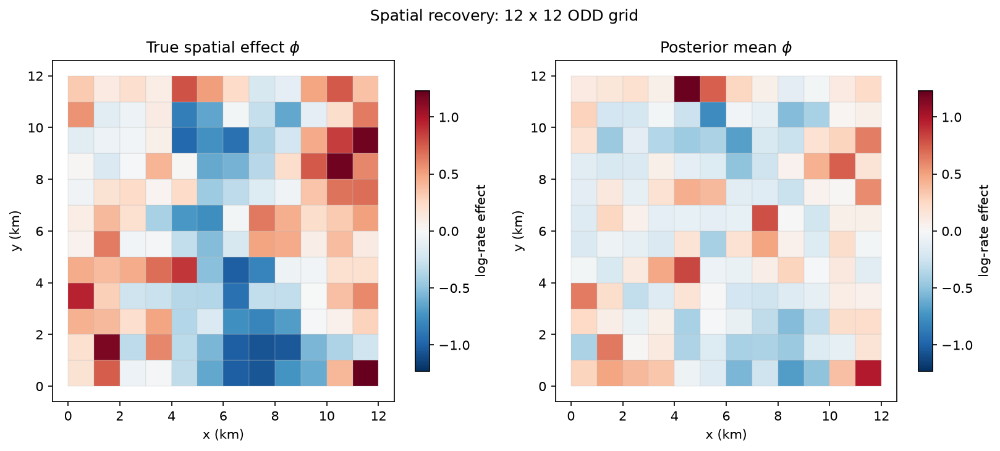
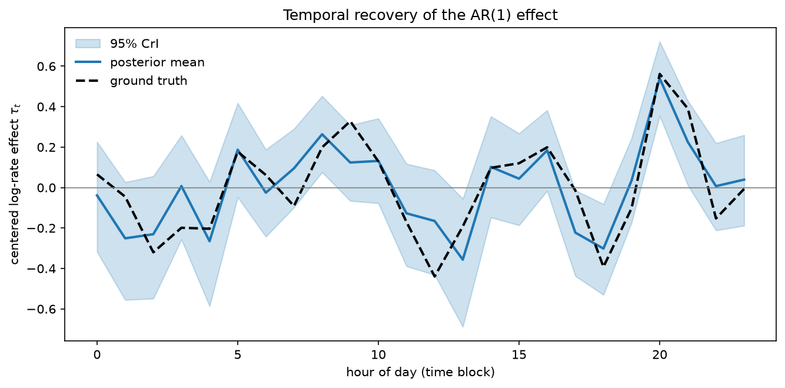
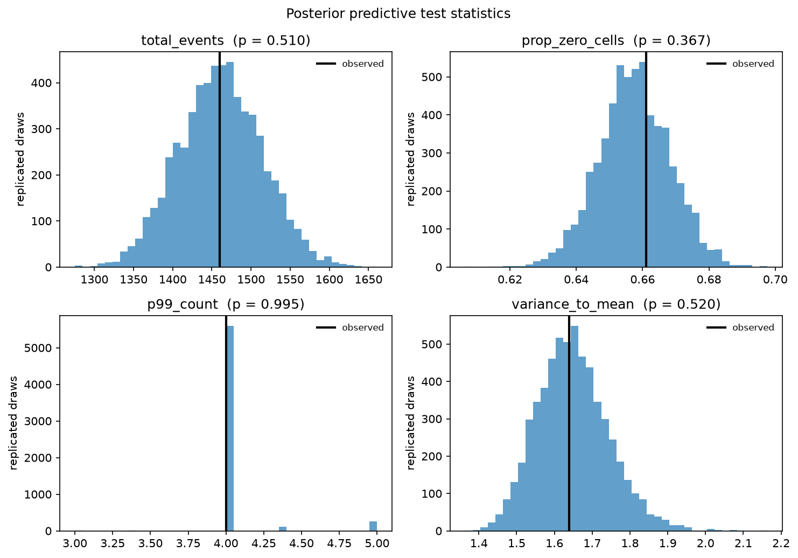
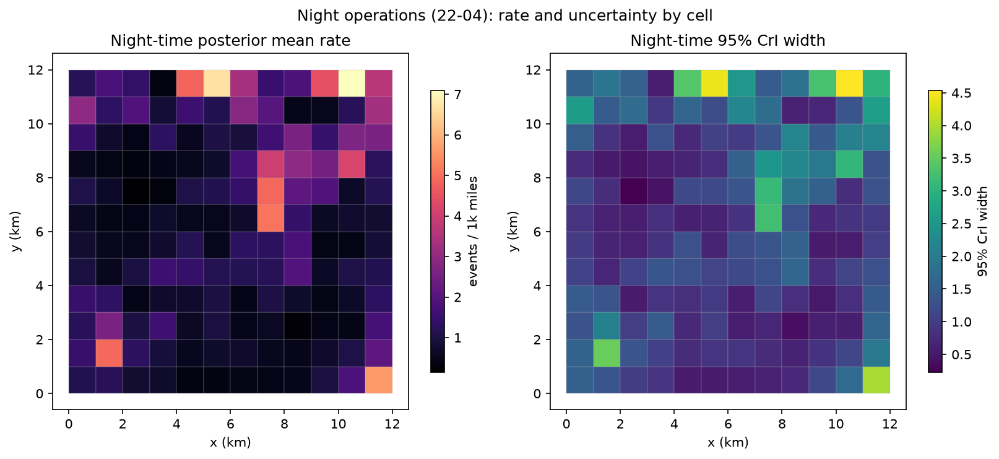

# BayesSpatioTemporalRisk

BayesSpatioTemporalRisk is a reproducible Bayesian spatio-temporal point-process pipeline for rare, safety-critical events in a simulated autonomous-vehicle fleet operating design domain (ODD). It turns raw geo-tagged event and per-vehicle mileage logs into a cell-by-hour exposure table with Spark SQL, fits a hierarchical ICAR + AR(1) Poisson model with a log-mileage offset in PyMC, and validates the posterior against known ground truth, frequentist baselines, LOO/WAIC, posterior predictive checks, and a prior-sensitivity sweep. The operational question it answers is: *Can the fleet expand night operations (time blocks 22-04) into Region 3 while holding the critical-event rate at or below 2.0 events per 1,000 miles with at least 95% posterior probability?* The final readout turns the posterior into a GO / NO-GO / INSUFFICIENT EVIDENCE assurance decision and documents exactly where the fleet-wide pooled GLM would mislead.

## Architecture

```
data/raw_events.parquet ──┐
                          ├──> Spark SQL: x/y binning + FULL OUTER JOIN rollup
data/raw_mileage.parquet ─┘             │
                                        ▼
                       data/exposure_table.parquet  (144 cells x 24 hours, 3,456 rows)
                       data/region_table.parquet    (6 regions x 24 hours)
                                        │
                                        ▼
                    PyMC hierarchical model (M3)
                    log(y) ~ alpha + X beta + region + ICAR phi + AR(1) tau + nugget
                    offset = log(exposure_miles / 1000)
                                        │
                    ┌───────────────────┼────────────────────┐
                    ▼                   ▼                    ▼
          artifacts/idata_bayes.nc  posterior rates   PPC / LOO / prior sweep
                    │                   │                    │
                    └───────────────────┴────────────────────┘
                                        ▼
                     assurance engine (region x time-slice draws)
                                        ▼
                         reports/risk_readout.md + figures/risk_map.png
```

### Modules

| Module | One-line description |
|---|---|
| `src/bstr/config.py` | Frozen `SimConfig` and `Priors` dataclasses, project paths, seed helpers. |
| `src/bstr/grid.py` | 12 x 12 cell geometry, rook adjacency, ICAR edge list, contiguous regions. |
| `src/bstr/simulate.py` | Seeded ground-truth simulator for spatial/temporal effects, exposure, raw event and mileage logs. |
| `src/bstr/aggregate.py` | PySpark local-mode SQL rollup from raw logs to the cell x time-block exposure table. |
| `src/bstr/baselines.py` | Pooled, fixed-effects, and negative-binomial Poisson GLMs with a common holdout split. |
| `src/bstr/model.py` | PyMC ICAR + AR(1) + region + nugget Poisson model, fitting, rate summaries, diagnostics. |
| `src/bstr/checks.py` | Posterior predictive checks, LOO/WAIC comparison, held-out density, prior sweep. |
| `src/bstr/readout.py` | Draw-level region/time assurance decisions, risk map, stakeholder memo, CLI. |
| `src/bstr/data.py` | Shared loaders and the one persisted holdout mask. |

## Model specification

For cell `c = 1..144`, hour-of-day `t = 1..24`, with exposure `e[c,t]` in thousands of miles:

```
y[c,t]      ~ Poisson(e[c,t] * exp(eta[c,t]))
eta[c,t]    = alpha + X[c] @ beta + u[region(c)] + phi[c] + tau[t] + eps[c,t]
```

Priors and random effects (all non-centered):

```
alpha                 ~ Normal(log(1.5), 1)
beta[j]               ~ Normal(0, 1),  j = 1, 2
u[r]                  = sigma_region * z_region[r],   z_region ~ Normal(0, 1)
sigma_region          ~ HalfNormal(1)

phi                   = sigma_phi * phi_raw
phi_raw               ~ ZeroSumNormal(1)
p(phi)                ∝ exp(-1/(2 sigma_phi^2) * sum_{(i,j) in E} (phi_i - phi_j)^2)   # ICAR
sigma_phi             ~ HalfNormal(1)

tau_raw[1]            ~ Normal(0, 1)
tau_raw[t]            = rho * tau_raw[t-1] + eps_t,   eps_t ~ Normal(0, 1)
tau                   = sigma_tau * tau_raw
rho                   = 2 * rho_raw - 1,              rho_raw ~ Beta(2, 2)
sigma_tau             ~ HalfNormal(1)

eps[c,t]              = sigma_nugget * z_nugget[c,t], z_nugget ~ Normal(0, 1)
sigma_nugget          ~ HalfNormal(1)
```

`E` is the 264-edge rook adjacency graph. The model is fitted on the 2,765 non-holdout rows; the 691 held-out rows are used only for out-of-sample scoring. The ICAR prior is built from the real rook edge list with a sum-to-zero field, the AR(1) prior uses a pairwise difference potential on the unit-variance series, and the nugget makes the likelihood log-Gaussian-Cox-like rather than plain Poisson.

## How to run

Python 3.11 and Java 17+ (for PySpark local mode) are required.

```bash
python3.11 -m venv .venv
source .venv/bin/activate
pip install -r requirements.txt
pip install -e .
make all
```

`make all` runs steps 1-6 in order: simulation -> Spark/SQL rollup -> frequentist baselines -> Bayesian fit -> checks/model comparison/prior sweep -> assurance readout. The measured wall-clock time for the complete run from empty `data/` on this build was **390 seconds (6.5 minutes)** on an 8-core Apple laptop with a warm PyTensor compilation cache; a first run also pays PyTensor C compilation time, which this measurement excludes. `make report` regenerates only `reports/risk_readout.md` and the risk map from existing artifacts.

Tests:

```bash
make test        # pytest -m "not slow" -q  (16 tests, no full sampling)
make test-slow   # includes the small-grid empirical-coverage test
make lint        # ruff check .
```

The held-out split is generated once with seed `20260101 + 303` and persisted to `data/holdout_mask.parquet`; every model in the repository loads that exact mask.

## Results

All numbers below were produced by the final `make all` run whose artifacts are in `artifacts/`.

### Dataset scale

| Quantity | Measured |
|---|---:|
| Raw geo-tagged event rows | 1,836 |
| Raw vehicle-segment mileage rows | 400,716 |
| Total fleet miles | 1,200,285 |
| Cell x time-block exposure rows | 3,456 |
| Critical-event rows | 95 |
| Observed events per 1,000 miles | 1.5296 (target 1.5) |
| Train / holdout rows | 2,765 / 691 |

The Spark rollup dropped 0 cell x time-block pairs under the 1.0-mile exposure floor, and event conservation validation passed (`sum(event_count) = 1,836`).

### Sampling diagnostics

| Quantity | Measured |
|---|---:|
| Chains x draws (tune) | 4 x 1,500 (1,000) |
| Target acceptance | 0.95 |
| Max R-hat (all parameters) | 1.0063 |
| Min bulk ESS | 731 |
| Min tail ESS | 1,821 |
| Divergences | 0 |
| Sampling wall clock | 79.0 s |
| Fit wall clock including PPC | 80.4 s |

### Parameter recovery

| Parameter | Truth | Posterior mean | 95% CrI | Covered |
|---|---:|---:|---|---|
| `alpha` | 0.154 | 0.072 | [-0.328, 0.490] | yes |
| `beta_intersection` | 0.450 | 0.523 | [0.410, 0.639] | yes |
| `beta_pedestrian` | 0.300 | 0.341 | [0.231, 0.449] | yes |

The spatial field correlates **0.731** with `phi_true` and the centered temporal effect correlates **0.829** with `tau_true`. The AR(1) persistence parameter is only weakly identified from 24 blocks: posterior mean `rho = 0.190` versus the true 0.75, while the fitted `tau` series still tracks the truth well.

### Calibration (headline)

**95.75%** of the 3,456 cell x time-block 95% credible intervals contain the true rate (**3,309 of 3,456**). This is the empirical coverage of the structural posterior rate `exp(eta)` without the observation-level nugget.

### Accuracy versus baselines

| Model | RMSE (rate / 1k miles) | MAE | Held-out mean log predictive density |
|---|---:|---:|---:|
| Bayesian hierarchical (M3) | **0.4675** | **0.3108** | **-0.8358** |
| Negative binomial | 0.9401 | 0.5685 | -0.8624 |
| Fixed-effects Poisson | 0.9340 | 0.5648 | -0.8704 |
| Pooled Poisson | 1.0927 | 0.7089 | -0.9027 |

The Bayesian model halves the point-estimate error of the best frequentist baseline and is best on the common 691-row held-out log predictive density.

### Model comparison

ArviZ LOO (higher elpd is better; `dse` is the SE of the difference from M3):

| Model | elpd_loo | Δ elpd | dse | p_loo | LOO weight | WAIC elpd | Pareto-k > 0.7 |
|---|---:|---:|---:|---:|---:|---:|---:|
| M3 full (ICAR + AR(1) + nugget) | **-2312.3** | 0.0 | 0.0 | 138.1 | **0.979** | **-2311.1** | 0 |
| M2 + AR(1) time | -2411.6 | 99.3 | 17.3 | 31.3 | 0.000 | -2411.5 | 0 |
| M1 + region pooling | -2440.6 | 128.3 | 21.3 | 10.5 | 0.014 | -2440.5 | 0 |
| M0 pooled Bayesian | -2501.0 | 188.8 | 24.6 | 3.9 | 0.007 | -2501.0 | 0 |

The full model improves LOO elpd over the pooled Bayesian baseline by **188.8 (SE 24.6)**. No model had a Pareto-k above 0.7; ArviZ did warn that some individual LOO folds were in the unreliable Pareto-k region, so the tail of the importance-sampling diagnostics is not perfect even though the >0.7 count is zero.

Held-out mean log predictive density for every fit (higher is better):

| Model | Mean log density | Total |
|---|---:|---:|
| M3 full | -0.8358 | -577.5 |
| Negative binomial | -0.8624 | -595.9 |
| M2 time | -0.8678 | -599.7 |
| Fixed-effects Poisson | -0.8704 | -601.4 |
| M1 region | -0.8803 | -608.3 |
| M0 pooled Bayesian | -0.9024 | -623.6 |
| Pooled Poisson | -0.9027 | -623.8 |

### Posterior predictive checks

Upper-tail Bayesian p-values `P(T_rep >= T_obs)` on the 2,765 training rows:

| Test statistic | Observed | Replicated mean | p-value |
|---|---:|---:|---:|
| Total event count | 1,460 | 1,460.7 | 0.511 |
| Proportion zero-count cells | 0.6611 | 0.6575 | 0.367 |
| 99th percentile count | 4.0 | 4.046 | 0.995 |
| Variance-to-mean ratio | 1.639 | 1.649 | 0.521 |

Total count, zero fraction, and dispersion are well calibrated. The discrete 99th percentile sits at the edge of its replicated distribution (observed 4 versus replicated mean 4.05), so the model slightly over-predicts the extreme upper tail; this is visible in the p99 panel of `figures/ppc_stats.png`.

### Prior sensitivity

Six full-model refits crossed sigma hyperpriors `HalfNormal(0.5/1/2)` with `beta ~ Normal(0, 0.5/2.0)` (250 draws, 250 tune, 2 chains), plus the Step 4 reference fit:

- Fleet-wide rate range: **1.5192 to 1.5296** events per 1,000 miles.
- **Maximum absolute shift: 0.0103 events per 1,000 miles.**
- Empirical coverage stayed between **95.2% and 95.9%**.
- LOO elpd stayed between **-2313.0 and -2310.3**.

### Headline assurance decision

Named question: *Can the fleet expand night operations (time blocks 22-04) into Region 3 while holding the critical-event rate at or below 2.0 events per 1,000 miles with at least 95% posterior probability?*

| Quantity | Measured |
|---|---:|
| Region / blocks | Region 3 (`region_id=3`) / 22, 23, 0, 1, 2, 3, 4 |
| Exposure in slice | 41,341 miles |
| Posterior mean rate | **0.855** events / 1k miles |
| 95% CrI | **[0.699, 1.026]** |
| P(rate <= 2.0) | **1.000** |
| Decision | **GO** |
| CrI width / target | 0.327 / 0.500 |
| Additional miles to target width | 0 |

The pooled Poisson GLM point estimate for the same slice is **1.302** events / 1k miles, which would also imply GO. The two approaches agree on the headline, but they diverge sharply at finer resolution: across all 18 region x time-slice decisions, the pooled model declares GO in **15**, while the Bayesian rule returns **12 GO, 4 NO-GO, and 2 INSUFFICIENT EVIDENCE**, disagreeing in **3** slices. The disagreements are concentrated in Region 4, where the pooled covariate-only estimate is 1.76-1.78 (GO) but the regionally resolved posterior is above 2.0 in the evening/day and straddles it at night. The highest-risk slices are Region 5 evening (**2.61** [2.25, 2.99], P(exceed) = 0.9997) and Region 4 evening (**2.52** [2.18, 2.90], P(exceed) = 0.9992), both NO-GO.

### Figures









## Limitations

- **Simulated data.** The ground truth is a seeded simulation, so the excellent recovery, calibration, and LOO results validate the pipeline rather than real-world safety performance.
- **ICAR identifiability and smoothing.** The intrinsic CAR prior is only identified up to an additive constant (handled with a sum-to-zero field) and shrinks local effects toward neighbours; the posterior-mean spatial field correlates 0.73 with truth. A hotspot smaller than a few cells can be attenuated. The AR(1) persistence parameter is weakly identified with 24 time blocks (`rho` posterior mean 0.19 versus truth 0.75).
- **Exposure assumed exact.** Fleet miles enter as a known offset with no measurement error or mis-binning model. Day-level exposure heterogeneity beyond the nugget is not represented, and the model treats the 60-day rate per cell x hour as constant.
- **No causal claim.** The covariates are simulated correlates, not interventions. The GO/NO-GO result is an assurance statement about the modelled event rate under the stated assumptions, not evidence that expanding operations causes a particular safety outcome.
- **Severity proxy.** The fitted outcome is all recorded safety events; critical events are a subset (95 observed, 0.079 per 1k miles). The all-event gate is stricter than a critical-only gate and is used conservatively.

## Repository layout

```
src/bstr/          package modules
scripts/           numbered pipeline entry points (01_simulate ... 06_readout)
tests/             pytest suite; tiny 4x4 x 6 fixture, Spark rollup, model sanity, decision logic
data/              generated parquet inputs/outputs (gitignored)
artifacts/         posterior draws, metrics, comparison tables (gitignored)
figures/           committed result figures
reports/           committed stakeholder memo
.github/workflows/ CI: Python 3.11 + Java 17, ruff, pytest -m "not slow"
```
